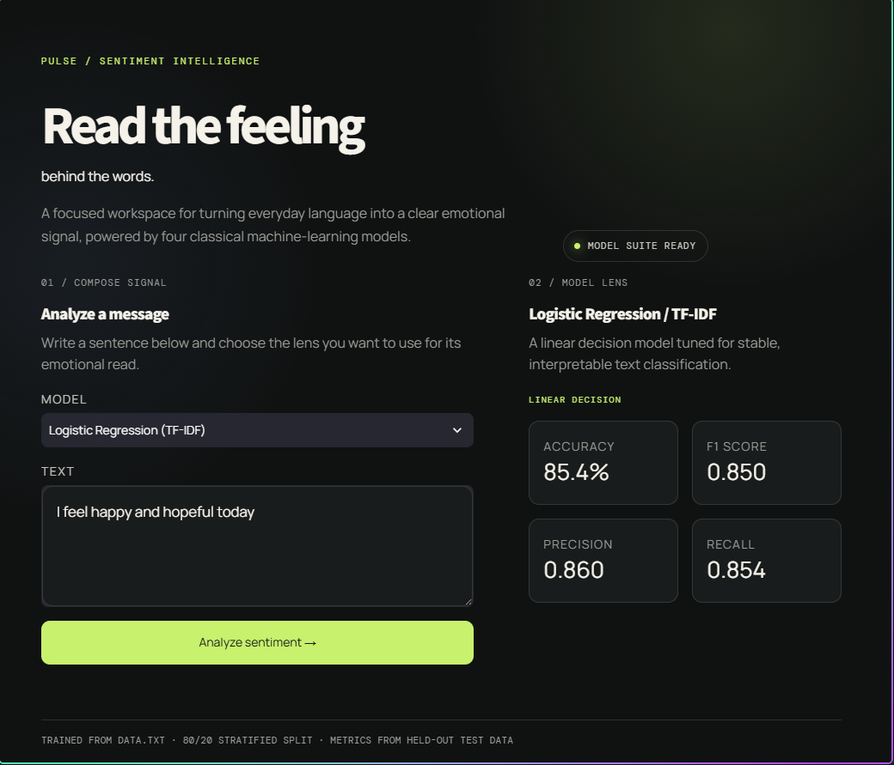

# Pulse | Sentiment Intelligence

A premium Streamlit workspace for classifying the emotional tone of text with classical machine-learning models, optimized with hyperparameter tuning and 5-fold stratified cross-validation.

[Live Demo](https://sentiment-analysis-with-machine-learning-by-ahnaf.streamlit.app/)



## Overview

Pulse cleans and analyzes text from the included `data.txt` dataset (16,000 labeled samples), then predicts one of six emotions:

- Joy
- Love
- Surprise
- Anger
- Sadness
- Fear

The interface lets you choose a model, enter a message, view the prediction with an emotion emoji, and inspect the selected model's cross-validation and test evaluation metrics.

## Models & Performance

All models are tuned using `GridSearchCV` and evaluated using **5-Fold Stratified Cross-Validation** inside leak-free Scikit-Learn `Pipeline`s:

| Model | Tuned Hyperparameters | 5-Fold CV F1 (Mean ± Std) | Test Accuracy | Test F1 (Weighted) | Status |
| :--- | :--- | :---: | :---: | :---: | :---: |
| **SVM (TF-IDF)** | `C=2.0`, `ngram=(1,2)`, `sublinear_tf=True` | **90.2% ± 0.7%** | **89.8%** | **0.898** | 🏆 **Best Model** |
| **Logistic Regression (TF-IDF)** | `C=10.0`, `ngram=(1,2)`, `sublinear_tf=True` | **89.0% ± 1.0%** | **88.7%** | **0.887** | Tuned |
| **Naive Bayes (BOW)** | `alpha=0.5`, `ngram=(1,2)`, `min_df=3` | **85.5% ± 0.8%** | **85.7%** | **0.856** | Tuned |
| **Naive Bayes (TF-IDF)** | `alpha=0.1`, `ngram=(1,2)`, `sublinear_tf=True` | **74.8% ± 0.5%** | **77.0%** | **0.760** | Tuned |

> 🏆 **Champion Model**: **SVM (TF-IDF)** achieves the highest 5-Fold CV F1 (90.2%) and Test Accuracy, making it the selected primary model in the application.

## Features

- **Automated Best Model Selection**: Identifies and selects the strongest model based on 5-fold cross-validation performance.
- **Leak-Free ML Pipelines**: Integrates text vectorization (n-grams `(1, 2)`, sublinear TF) and classification directly into Scikit-Learn `Pipeline` objects to avoid training/validation fold leakage.
- **5-Fold Stratified Cross-Validation**: Validates that models generalize robustly across imbalanced emotion classes.
- **Interactive Streamlit Workspace**: Dynamic model switcher with real-time CV F1, Accuracy, Precision, Recall, and F1 metrics.
- **Live Inference & Export**: Best pipeline is saved to `best_sentiment_model.pkl` for single-step production inference.

## Run Locally

### 1. Clone the repository

```bash
git clone https://github.com/iamahnaf/Sentiment-Analysis-with-Machine-Learning.git
cd Sentiment-Analysis-with-Machine-Learning
```

### 2. Install dependencies

```bash
python -m pip install -r requirements.txt
```

### 3. Start Streamlit

```bash
python -m streamlit run app.py
```

Open the local URL shown in the terminal, usually `http://localhost:8501`.

## Deploy with Streamlit Community Cloud

1. Push this repository to GitHub.
2. Open [Streamlit Community Cloud](https://share.streamlit.io/).
3. Choose **New app**.
4. Select this repository and the `main` branch.
5. Set the main file to `app.py`.
6. Deploy.

Streamlit will install the packages from `requirements.txt` and use `data.txt` from the repository at runtime.

## Project Structure

```text
.
├── app.py                    # Streamlit application with CV metrics & model selector
├── best_sentiment_model.pkl  # Exported champion pipeline (SVM TF-IDF)
├── data.txt                  # Labeled sentiment dataset (16,000 samples)
├── requirements.txt          # Python dependencies
├── Sentiment_Analysis.ipynb  # Comprehensive EDA, baseline, CV & hyperparameter tuning
└── docs/
    └── ui-preview.png        # Application screenshot
```

## Methodology & Evaluation

1. **Text Preprocessing**: Lowercasing, punctuation removal, digit removal, ASCII normalization, and English stop-word filtering.
2. **Cross-Validation (`StratifiedKFold`)**: 5 folds preserving class distributions.
3. **Hyperparameter Tuning (`GridSearchCV`)**:
   - N-gram ranges: `(1, 1)` vs `(1, 2)` (capturing multi-word emotional signals like "not happy")
   - Sublinear term-frequency scaling (`sublinear_tf=True`)
   - Regularization $C$ for linear models (`0.5`, `1.0`, `2.0`, `5.0`, `10.0`)
   - Smoothing $\alpha$ for Naive Bayes (`0.1`, `0.5`, `1.0`)
4. **Final Model Selection**: The model with the highest cross-validation score is selected and evaluated on the 20% held-out test split with full confusion matrix and classification reports.

## License

This project is intended for educational and demonstration purposes.
